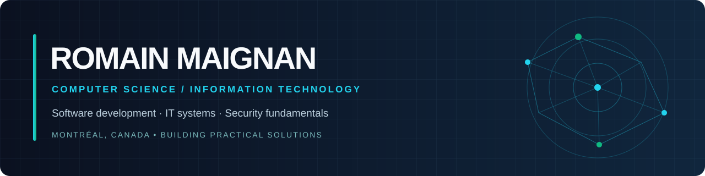

## Computer Science Technology · Software & IT

**OOP · Web & Mobile Development · Operating Systems · Technical Support · Cybersecurity **

**Thoughtful code. Practical solutions.**

 

<!-- Add verified links once the account and website have been published:
[Portfolio](https://YOUR_GITHUB_USERNAME.github.io/)
[LinkedIn](https://www.linkedin.com/in/YOUR_PROFILE/)
-->

---

## About me

I'm a **Computer Science Technology (Programming) DEC student at LaSalle College in Montréal**. My coursework includes software development, operating systems, technical support fundamentals, and iOS development. I am also did **Google Cybersecurity Professional Certificate training **.

I enjoy working across application development and practical IT problem-solving. My previous experience in customer-facing and operational environments has helped me develop a service-oriented approach, teamwork, reliability, and communication.

**Currently seeking:** IT internship opportunities for **summer 2027** in Montréal, Laval, Saint-Eustache, and nearby communities. I am also open to discussing appropriate project collaborations.

## Technical foundation

My Computer Science Technology studies cover programming and broader IT fundamentals. The following skills combine coursework and academic project exposure; proficiency varies by technology.

| Area | Technologies & concepts |
| --- | --- |
| **Programming & OOP** | Java, C#, Python; object-oriented programming (classes, objects, encapsulation, inheritance, polymorphism, abstraction) |
| **Web development** | HTML5, CSS3, JavaScript, ASP.NET MVC |
| **Data structures & algorithms** | Fundamental data structures, algorithms, and problem-solving |
| **Databases** | SQL, relational database design, data modeling, Firebase Firestore |
| **APIs & integrations** | REST APIs, JSON, data handling and application integration |
| **Mobile development** | Android Studio, Java, Android projects; iOS development coursework |
| **Systems & technical support** | Windows and Linux fundamentals, troubleshooting, operating systems coursework |
| **Networking fundamentals** | TCP/IP, DNS, DHCP; concepts to demonstrate through upcoming labs |
| **Development workflow** | Git version control, GitHub, software development life cycle (SDLC), debugging, testing and documentation |
| **Cybersecurity** | Security fundamentals; Google Cybersecurity Professional Certificate training |

**Programming concepts:** Object-oriented design · Encapsulation · Inheritance · Polymorphism · Abstraction · Data structures & algorithms · Debugging & testing

*These are areas of study or project exposure, not claims of advanced professional experience. Specific competencies will be backed by repository examples as projects are published.*

## Featured academic projects

**Software & applications** — academic work with source repositories and documentation being prepared. No source code links are published yet.

| Project | Focus | Status |
| --- | --- | --- |
| **Used Book Exchange & Marketplace** | Java, Android, Firebase; book listings and borrowing/exchange/sale workflows | 📁 Preparing repository |
| **Product Management System** | C#, ASP.NET MVC, EF Core; CRUD operations | 📁 Preparing repository |
| **Restaurant Android Application** | Java, Android Studio, XML; navigation and UI | 📁 Preparing repository |
| **Countries API** | API-related data workflows | 📁 Preparing repository |

**IT systems & security** — planned portfolio labs (not yet completed).

| Planned lab | Evidence to publish | Status |
| --- | --- | --- |
| **IT Infrastructure & Troubleshooting Lab** | Windows/Linux setup, account management, permissions, connectivity troubleshooting, screenshots | 🧭 Planned |
| **Cybersecurity Home Lab** | Authorized network analysis, sample log reviews, incident writeups, security scripts | 🧭 Planned |
| **IT Support Knowledge Base** | Reproducible troubleshooting tickets, diagnosis steps, resolutions, validation | 🧭 Planned |
| **Networking Fundamentals Lab** | TCP/IP, DNS, DHCP, VPN concepts, diagrams and troubleshooting | 🧭 Planned |
| **Software QA & Testing** | Test cases, defect reports, reproducible test runs | 🧭 Planned |

*I will replace these status labels with actual links when the corresponding work is uploaded and verified.*

## What to expect in each repository

For completed work I aim to include a clear description, my specific contributions, the technology stack, setup steps, screenshots or a demo where useful, tests or verification steps, and known limitations.

## Professional development

- **DEC — Computer Science Technology (Programming)** · LaSalle College · In progress
- **Google Cybersecurity Professional Certificate** · Training in progress; **certificate not yet earned**
- Continued learning in systems, technical support, networking, and practical security

## Professional strengths

**Customer communication** · **Team collaboration** · **Operational reliability** · **Technical curiosity** · **Documented problem-solving**

## Connect

**Email:** [romemaignan@gmail.com](mailto:romemaignan@gmail.com)  
**Location:** Montréal area, Québec  
**Availability:** Summer 2027 IT internship; appropriate technical collaborations

<!-- Before publishing: add your real GitHub and LinkedIn URLs, and only list skills you can discuss confidently in an interview. -->
